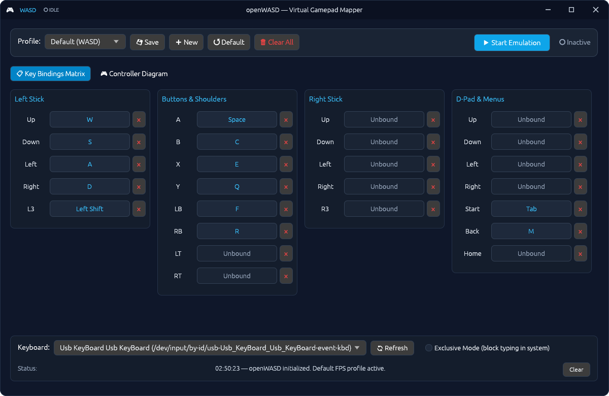

# openWASD 🎮

> **Turn your keyboard into a virtual Xbox 360 controller on Linux with ultra-low latency.**

[](https://www.rust-lang.org/)
[](https://kernel.org/)
[](https://github.com/emilk/egui)
[](LICENSE)



---

## 💡 About openWASD

On Windows, gamers have powerful tools like *reWASD* or *x360ce* to emulate an Xbox controller using a keyboard. On Linux, however, the ecosystem was missing a dedicated, modern solution — utilities like *AntiMicroX* do the exact opposite (gamepad ➔ keyboard).

**openWASD** fills this gap. Built natively in pure Rust with direct Linux kernel `/dev/uinput` integration, it creates a real, system-recognized Microsoft Xbox 360 virtual gamepad that works out of the box with **Steam, Proton, Wine, RPCS3, Ryujinx, RetroArch**, and any native Linux game.

---

## ✨ Features

- **🎮 Authentic Xbox 360 Emulation**: Direct kernel-level virtual gamepad creation via `/dev/uinput`. Fully recognized by SDL2, Steam Input, and Wine/Proton.
- **🗺️ Interactive Controller Diagram**: A visual, spacious Xbox 360 controller layout with real-time button press feedback, 1-click key rebinding, and right-click unbinding.
- **📋 Dual Layout Modes**:
  - **Diagram View**: Visual mapping directly on an interactive controller blueprint.
  - **Columns View**: Clean 4-column matrix for rapid reassignment of all 21 inputs.
- **⚡ Sub-Millisecond Input**: Low-latency event loop using Linux `evdev` background threads.
- **🔒 Exclusive Mode**: Optionally grab the keyboard device during emulation to prevent keystrokes from typing into other applications while gaming.
- **💾 Profile Manager**: Save, export, and switch between custom mapping profiles stored as human-readable JSON files in `~/.config/openwasd/profiles/`.
- **🖥️ Modern Desktop Integration**: Custom client-side decorations (CSD), responsive window resizing, and application menu desktop launcher (`.desktop`).

---

## 🚀 Quick Start

### 1. Requirements

- **Linux** with `uinput` kernel module enabled (standard on Arch, Ubuntu, Fedora, Debian, Pop!_OS, etc.).
- Access to `/dev/uinput` and `/dev/input/event*` (configured via a simple one-time udev rule).

---

### 2. Permissions Setup (One-time)

To allow openWASD to create virtual input devices and listen to your keyboard without requiring `sudo` every time:

```bash
chmod +x setup_permissions.sh
./setup_permissions.sh
```

> **Note:** The script configures a modern systemd `uaccess` udev rule (`/etc/udev/rules.d/99-openwasd.rules`) and applies immediate ACL permissions for your active session without requiring a reboot.

---

### 3. Running from Source

Make sure you have Rust installed ([rustup.rs](https://rustup.rs)):

```bash
git clone https://github.com/LeviLeal/openWASD.git
cd openWASD

# Run directly
cargo run --release
```

Or simply use the launcher script:

```bash
./run.sh
```

---

### 4. Desktop Integration

To add openWASD to your application menu (GNOME, KDE Plasma, XFCE, etc.):

```bash
./install.sh
```

To remove the desktop shortcut later:

```bash
rm ~/.local/share/applications/openwasd.desktop
```

---

## 📦 Building a Release Tarball

To package a standalone, self-contained distribution archive for Linux:

```bash
./package.sh
```

The resulting archive will be placed in `dist/openwasd-v0.2.0-linux-x86_64.tar.gz`.

---

## 🛠️ Architecture

```
┌────────────────────────┐
│    Physical Keyboard   │
└───────────┬────────────┘
            │  /dev/input/event* (evdev)
            ▼
┌────────────────────────┐
│  Keyboard Interceptor  │ ── Background worker thread with event capture
└───────────┬────────────┘
            │
     Mapped Inputs
            │
            ▼
┌────────────────────────┐
│    Virtual Gamepad     │ ── Submits input packets via /dev/uinput
└───────────┬────────────┘
            │
            ▼
┌────────────────────────┐
│  Linux Kernel / Games  │ ── Recognized as Microsoft X-Box 360 Pad
└────────────────────────┘
```

---

## 📜 License

This project is licensed under the **GNU General Public License v3.0** (GPL-3.0) - see the [LICENSE](LICENSE) file for details.
